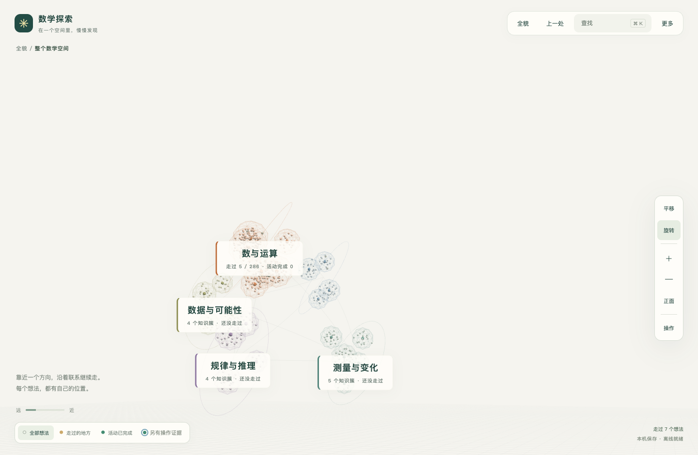
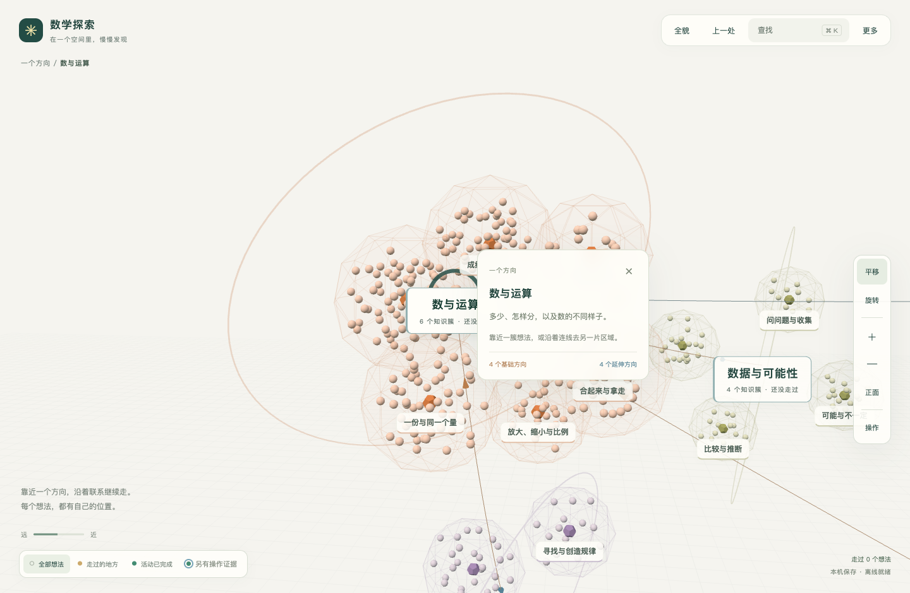
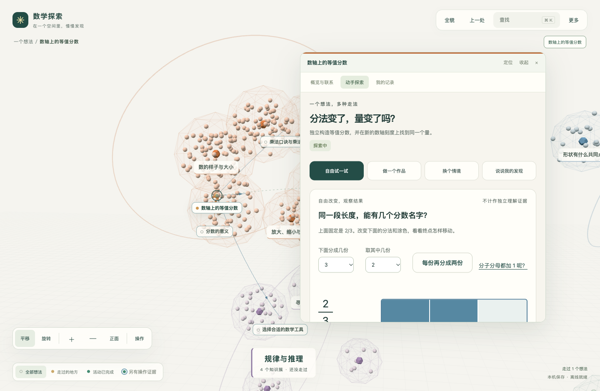

# 数学探索视觉优化方向

2026-10-24。本轮只评估现有视觉和提出方向，没有修改应用代码。使用用户已授权的独立 Playwright 浏览器，检查当前全貌，以及隔离上下文中的靠近、展开内容两个状态。截图均为本轮捕获并逐张打开检查；不是效果图。

## 当前三个状态

1. 全貌：空间可以观察和旋转，主题标签易读；当前视角存在较大空白，不同区域都呈相似球团，图形与空间的标签在这个观察角度未显示。该截图是已有观察位置，不代表初始默认布局。次要文字较小，浅色细线可见性弱。

2. 靠近：知识簇开始出现，区域色彩延续；网状外壳、主题大环、真实关系线叠在一起，视觉语义难区分。中心主题标签与信息卡有遮挡，多个簇外观相似，节点主要靠标签识别。

3. 展开工作面：活动可读且仍保留世界背景；大面板包含重复标题、两排导航和嵌套内容框，占据主要视线。工作面与所属对象的连接在密集背景中较弱，空间与阅读内容之间的连续感仍有改进空间。

## 推荐方向

延续浅色、低饱和配色，做有明确区域和可读对象的立体知识地图。通过轮廓、光照、遮挡和镜头表现前后关系；通过箭头表达知识关系。方位和距离仍不赋予尚未建立的数学语义。

- 移除知识簇外壳的三角网格线，减淡地面网格与主题大环，给真实关系线留出清楚的视觉层次。
- 五个主题保留各自色彩并有可辨认的区域轮廓；知识簇形成疏密有别的小群落。近处节点呈现名称，远处合并为简洁轮廓，减少同样的小球大量重复。
- 聚焦时突出对象及直接关系，其他对象保留轻量背景。基础和延伸的箭头清楚可见，附短语说明；区域边界、知识关系、工作面牵引使用不同线型。
- 保留世界坐标稳定；运用柔和明暗和适度透视增强体积感。文字面向观察者，保持阅读尺寸；镜头平滑靠近，避免持续自转或突然穿过对象。
- 工作面从所属对象旁展开，所属对象与邻接关系保持可见。减少重复标题、嵌套边框和导航，支持小幅预览、展开、并排查看。
- 主题色保持归属含义；探索和活动完成使用描边、填充或小标记，并辅以文字。独立证据继续与完成区分，不能只靠颜色传递状态。

先处理区域辨识、网格减噪和标签遮挡，再处理关系线与工作面的连接，最后调整光照和动画。具体知识点的交互表现不纳入这一轮建议。

## 判断边界

以上是基于截图和实际可操作界面的视觉判断。本轮未量测对比度、检查屏幕阅读器，也未做儿童辨认、晕动或理解测试，不能据此声称无障碍合规或学习效果提高。
